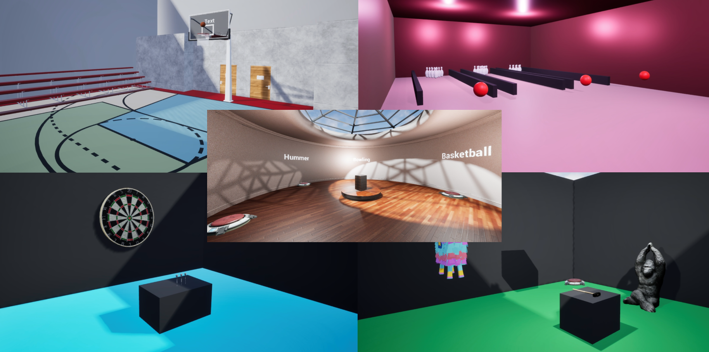

## PROYECTO: Interacción en Realidad Virtual - Minijuegos
Alumno: Guillermo Mata Vizcaíno

>Para probar y utilizar este proyecto sin necesidad de gafas de Realidad Virtual físicas, es obligatorio ejecutar el archivo `LanzarConSimulador.bat` incluido en la carpeta

## TABLA DE CONTROLES
* **Movimiento del Jugador (Simulador XR):** Tecla WASD y desplazamiento con el ratón (`WASD - Mouse`)
* **Agarrar objeto (Simulador XR):** Doble clic en Mouse 3 (`Double Click - Mouse 3`)

## LISTA DE MEJORAS Y GAME FEEL IMPLEMENTADAS
* Sistema de teletransportes que conectan un lobby con los minijuegos. Utilizan un fundido a negro para reubicar al jugador instantáneamente sin provocar mareos.
* Decoración tematizada de cada uno de los mininjuegos para mejorar la inmersión
* Sistema de puntuación para el minijuego de los dardos y el baloncesto. En el caso de los dardos, dependiendo donde golpee será una puntuación u otra.
* Impulso en los objetos para mejorar la jugabilidad en el modo simulador guiado por la mirada del propio jugador.
* Agarre Snap en objetos para orientarlos en la dirección correcta y no aleatoriamente por donde lo agarre el jugador.

 

